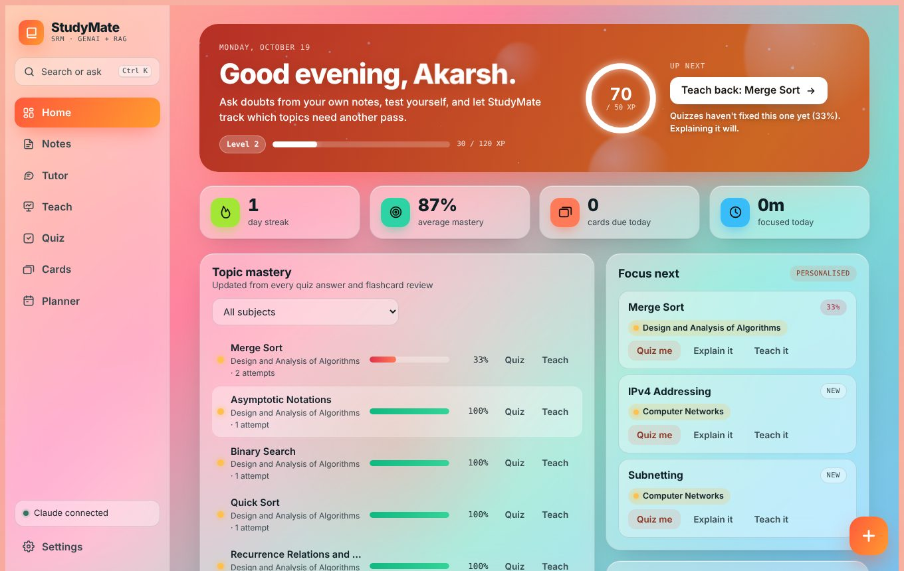
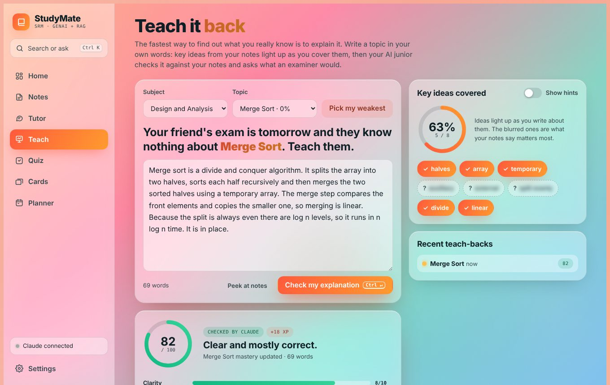
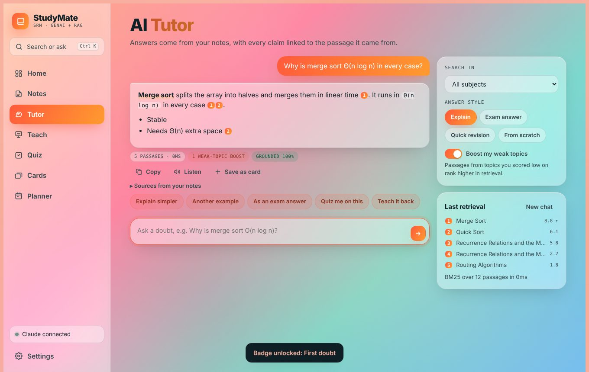
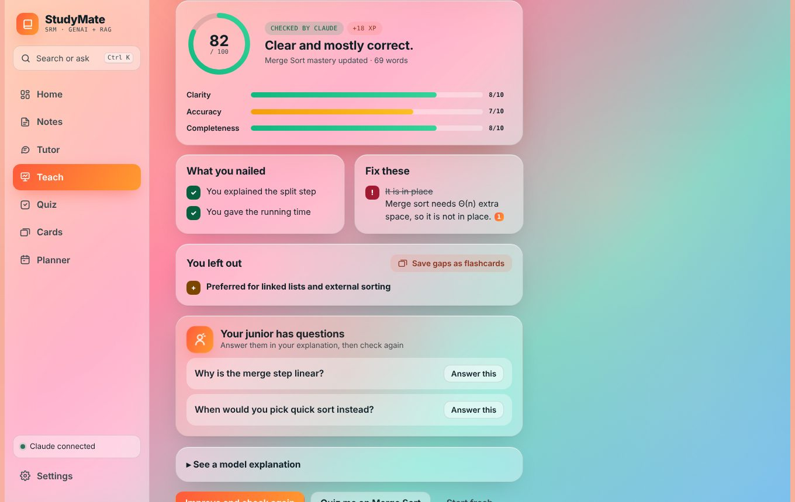
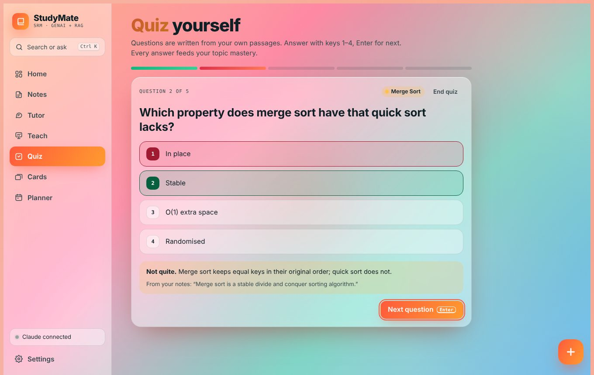
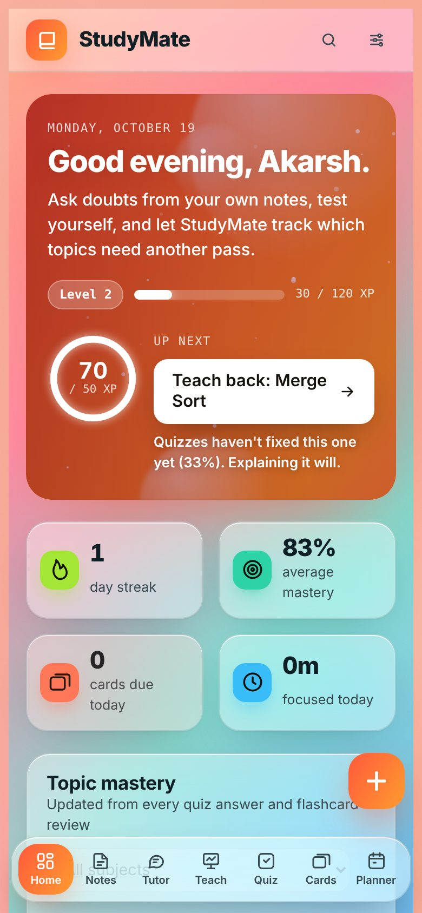
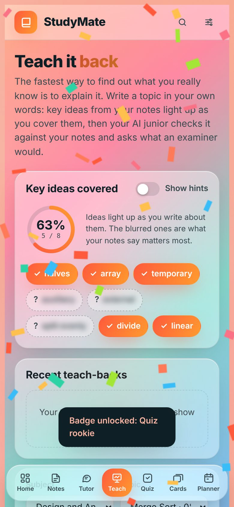

# SRM StudyMate AI

A GenAI + RAG personalised learning companion for SRM students. Upload your own syllabus units, notes and PYQs, then ask a tutor that answers from them with citations, quiz yourself, teach topics back in your own words, review flashcards, plan for exams and study in focused blocks while StudyMate tracks which topics need another pass.



| Teach it back | Tutor with citations |
|---|---|
|  |  |
| **AI feedback on your explanation** | **Quiz from your own notes** |
|  |  |

<p align="center"> &nbsp; </p>

## What's new in v2.4

- **Tested end to end**: a 54-check browser test suite now covers every feature, including all AI paths (via a mock Claude runtime), AI failures, hostile note text, empty state, blocked storage, large notes, PDF upload, the focus timer, accessibility (axe-core) and a 360 px phone layout. See [Testing](#testing).
- **Flashcard deck browser**: search, edit and delete any card, with Undo.
- **Flashcards**: "Again" now sends a card to the back of today's queue instead of hiding it for a minute.
- **Quiz**: an *End quiz* button (answered questions still count), and the "From your notes" quote is now the most relevant sentence from the question's own topic, even when the AI cites the wrong passage number.
- **Tutor**: your conversation survives a page reload; *New chat* clears it.
- **Notes**: subject names merge regardless of case or spacing ("operating  systems" joins "Operating Systems"), and adding the same note twice is refused.
- **Accessibility**: page language set, keyboard focus stays inside dialogs, and hero, button and badge text now meets WCAG AA contrast (4.5:1) in every colour world.
- **Phone**: a more compact hero; Teach topic labels update right after a check.

## Pipeline

```
Knowledge ingestion (once per upload)
  Notes / PDFs ─▶ Parse ─▶ Structure (topics) ─▶ Chunk ─▶ BM25 index

Runtime (per question)
  Student query ─▶ RAG retrieval ─▶ LLM (Claude) ─▶ Grounding check ─▶ Learning modules ─▶ Dashboard
                        ▲                                                     │
                        └──── Personalisation router (weak-topic boost) ◀─────┘
```

## Features

- **Home**: greeting, level + XP bar, daily XP goal ring, smart "Up next" (exam prep → due cards → teach-back for stubborn topics → weakest topic), streak / mastery / due / focus stats, topic mastery, 16-week activity heatmap, achievements, getting-started checklist, recent activity
- **Notes**: PDF / TXT / MD upload or paste (or drop a file anywhere); heading-aware chunking with topic tags; per-subject readiness, one-tap **AI cheat sheet** (copy or download as Markdown), quiz and ask shortcuts; Undo after removing a note
- **AI Tutor**: BM25 retrieval, cited answers `[1]` linked to source passages, groundedness score, four answer styles; follow-ups (simpler, another example, exam answer, quiz me, teach it back), copy, read-aloud, save answer as a flashcard; chat history kept across reloads
- **Teach it back (Feynman mode)**: pick a topic and explain it in your own words. Key ideas pulled from your notes start blurred and light up live as you cover them, with a coverage ring. "Check my explanation" has an AI junior grade it against your notes (clarity, accuracy and completeness, what you nailed, misconceptions with citations, what you left out) and ask two follow-up questions you can answer and re-check. Gaps become flashcards in one tap, the score feeds topic mastery, and drafts autosave. Works offline using key-idea coverage
- **Quiz**: MCQs written from your own passages; Easy / Mixed / Hard; exam mode with a 45 s timer; keys 1–4 and Enter; End quiz any time; full answer review; missed questions turn into cards
- **Flashcards**: 5-box spaced repetition, AI or hand-written cards, keyboard flip and rating, deck browser with search, edit and delete
- **Exam planner**: add exam dates; StudyMate spreads weak and unstarted topics across the days left and shows today's plan with Quiz / Learn buttons
- **Focus timer**: 25/5, 50/10, 15/3 Pomodoro blocks tagged by subject; 1 XP per focused minute; running timer stays visible in the sidebar
- **Gamification**: XP, levels, 14 badges, streaks, daily goal
- **Ease of use**: floating quick-action button (ask, quick quiz, teach, review, 25-min focus, add notes); one-tap **Quick 5** quiz on weak spots; select any text in an answer or your notes to explain it, copy it or turn it into a flashcard; `?` shows all keyboard shortcuts
- **Command palette** (Ctrl/⌘ K or /): search your notes, jump to any topic, run actions, or type a doubt and press Enter to ask the tutor
- **Settings**: name, colour world, text size, calm motion, daily goal, backup download / copy, restore, reset
- **Offline mode**: without an LLM, the tutor returns best-matching passages, quizzes become fill-in-the-blank and teach-backs are scored on key-idea coverage

## Run

Single file, no build step: open `index.html` in a browser. AI features use the Claude artifact runtime (`window.claude.use("sample")`); elsewhere the app runs in offline mode. Data is stored in the browser's `localStorage` (earlier versions' data carries over).

## Testing

```bash
pip install playwright reportlab pillow && playwright install chromium
python tests/e2e.py
```

`tests/e2e.py` drives the real app in headless Chromium with `tests/mock_claude.js` standing in for the Claude runtime, so every AI path (tutor streaming and stop, quiz JSON, flashcards, cheat sheet, teach-back grading) is tested without network access, along with failure fallbacks, XSS safety, empty state, blocked storage, a ~330k-character notes performance check, backup/restore, the focus timer (fake clock) and layout at 1360 px and 360 px.

Optional extras:

```bash
npm i pdfjs-dist@3.11.174 axe-core@4.10.2
PDFJS_DIR=node_modules/pdfjs-dist/build AXE=node_modules/axe-core/axe.min.js python tests/e2e.py
```

`PDFJS_DIR` serves pdf.js locally so the PDF upload path runs offline; `AXE` adds axe-core accessibility checks on every page. `python tests/screenshots.py` regenerates the images above.

## Project layout

```
index.html               the whole app (HTML, CSS, JS in one file)
tests/e2e.py             end-to-end test suite (54 checks)
tests/mock_claude.js     mock Claude runtime used by the tests
tests/screenshots.py     regenerates docs/screenshots
docs/screenshots/        README images
```

## Tech

Vanilla JS, BM25 retrieval, pdf.js for PDF text extraction, Claude for generation, Web Audio for the timer chime, Speech Synthesis for read-aloud. Tested with Playwright and axe-core.

## Roadmap

- Backend (FastAPI) with embeddings + vector store for semantic retrieval
- User accounts and synced progress
- PYQ-aware question weighting
